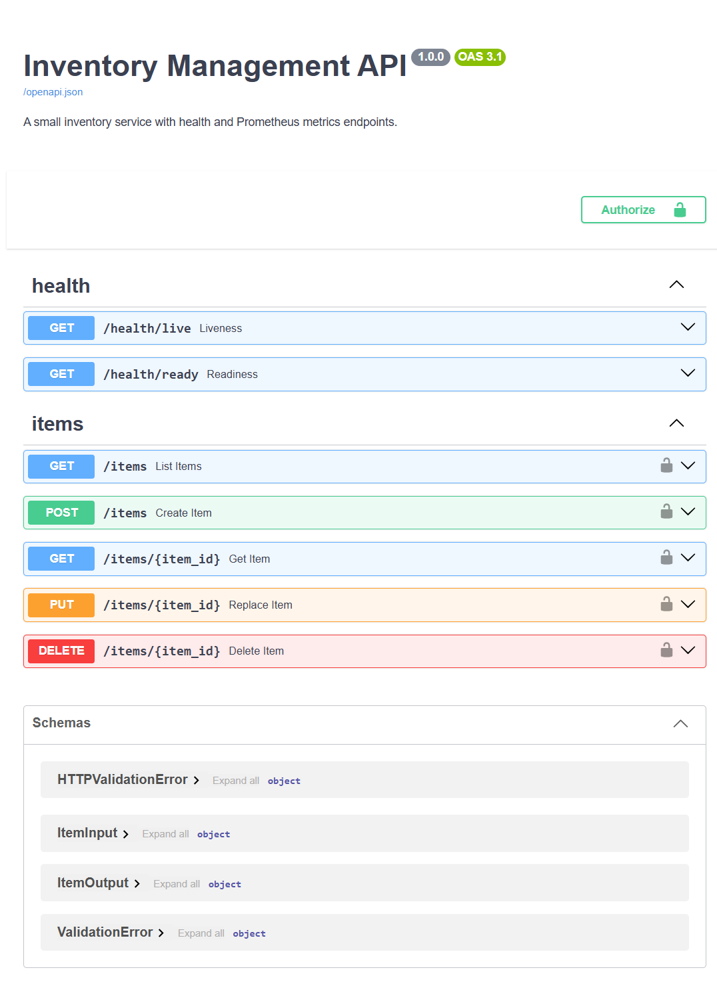
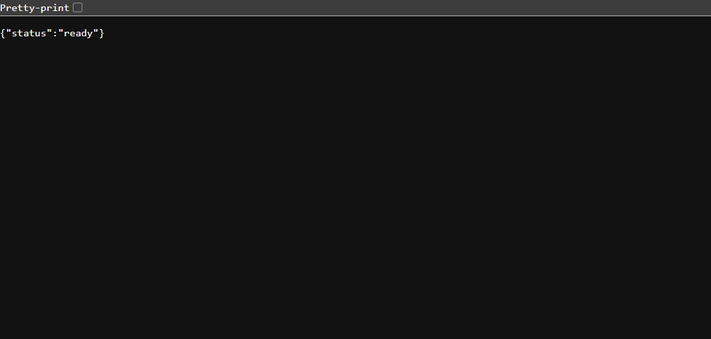
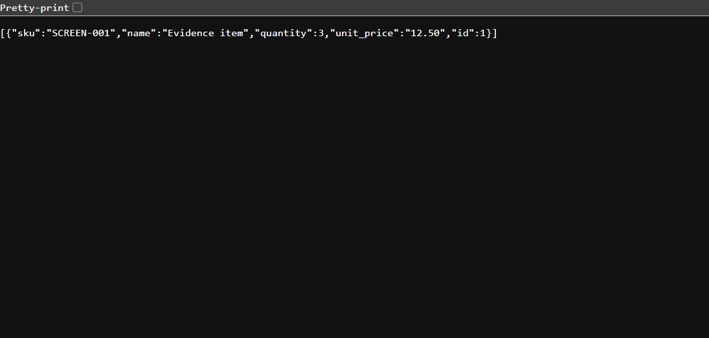

# End-to-End DevOps Automation Platform for an Inventory Management API

**Capstone document**

**Project repository:** <https://github.com/Vaishnavi778/DEVOPS-PROJECT>

**Application:** Inventory Management REST API

**Deployment strategy:** Kubernetes canary rollout with Argo Rollouts

**Date:** 25 November 2026

> Before uploading to ZOSIMA, add student/group details and capture genuine screenshots from the repository, successful CI run, local API, Kubernetes rollout, and monitoring dashboard. Do not represent an unrun cloud deployment as completed.

## 1. Abstract

This project implements an automated software-delivery path for an inventory API, from source commit through tests and security checks to a container image and an approval-gated Kubernetes release. The application stores inventory records in PostgreSQL and exposes health and Prometheus metrics endpoints. Kubernetes runs the API through Argo Rollouts, which progressively shifts capacity and uses Prometheus success-rate analysis to detect regressions. Terraform describes an optional private AWS EKS foundation. Operational documentation covers monitoring, logging, secret handling, and recovery.

The workflow is designed to be reproducible locally with Docker Compose and kind, without requiring cloud credentials. Cloud infrastructure is optional because it incurs cost and requires environment-specific access, secret, and backup controls.

## 2. Problem statement

Manual build and deployment processes can produce inconsistent releases, miss defects until production, expose credentials, and make it difficult to identify or recover from failed changes. A capstone delivery platform should make the path from version-controlled code to a running service repeatable, testable, observable, and recoverable.

## 3. Objectives and scope

### Objectives

1. Provide a real API and PostgreSQL-backed inventory data model.
2. Automate linting, tests, dependency and configuration security checks.
3. Build a least-privilege container and publish immutable commit-tagged images.
4. Deploy to Kubernetes using health probes and a canary strategy with metric analysis.
5. Describe optional cloud infrastructure as code.
6. Document reproducibility, observability, security, and recovery.

### Scope and assumptions

- GitHub is the version-control and automation platform; GHCR stores images.
- kind is the default evaluation cluster. AWS EKS is an optional cloud extension.
- Production credentials, cluster, domain, and managed database are supplied by the deployment owner; none are embedded in this repository.
- A GitHub-hosted CI run can build and publish the image. Production deployment uses a protected GitHub Environment and a self-hosted runner with network access to the private cluster.

## 4. Architecture and design

```text
Developer
   | commit / pull request
   v
GitHub repository ----> CI: Ruff + pytest + pip-audit + Trivy
   | main push
   v
GHCR image (commit SHA)
   | manual workflow_dispatch + production approval
   v
Kubernetes migration Job -> Argo Rollouts (20% -> 50% -> 100%)
                                      |          |
                                      v          v
                               FastAPI replicas  PostgreSQL
                                      |
                          /metrics + JSON stdout logs
                              |               |
                          Prometheus       Alloy -> Loki
                              |
                       Argo canary analysis

Terraform (optional): private AWS VPC + EKS managed node group
```

### Main components

| Layer | Implementation |
|---|---|
| Version control | GitHub repository with pull-request and main-branch workflows |
| Application | FastAPI inventory CRUD service, SQLAlchemy persistence, Alembic migrations |
| Database | PostgreSQL 16; Compose and kind evaluation setup; managed database recommended for production |
| CI | GitHub Actions lint/test/security checks and pytest result artifact |
| Containerization | Python 3.12 slim image, non-root runtime user |
| Registry | GHCR, image tagged with source commit SHA |
| Orchestration | Kubernetes namespace, StatefulSet/PVC for local DB, probes, resource bounds, PDB |
| Deployment | Argo Rollouts canary, Prometheus AnalysisTemplate, manual approval before production |
| Infrastructure | Terraform VPC and private-endpoint AWS EKS module configuration |
| Observability | Prometheus metrics, Grafana dashboards/alerts, JSON stdout logs, Loki/Alloy runbook |
| Security | Input validation, secret injection, least-privilege workflow permissions, Trivy and pip-audit |

## 5. Implementation

### Application

The API supports creating, listing, reading, replacing, and deleting inventory items. Business endpoints require an `X-API-Key`; SKUs are unique and format-validated, and quantity and price cannot be negative. `/health/live` reports process liveness, `/health/ready` checks database and authentication configuration, and `/metrics` exports Prometheus counters. Database schema changes are versioned in Alembic rather than applied implicitly at application startup.

### Pipeline

Pull requests run Ruff, focused API tests, a Python dependency audit, and Trivy filesystem checks. A successful push to `main` builds and publishes the image tagged by the exact Git commit SHA. A separate manually triggered workflow is protected by GitHub Environment approval; it runs database migration before updating the Kubernetes Rollout and waits for rollout health.

### Deployment and recovery

Argo Rollouts introduces the image progressively at 20%, 50%, and 100% replica capacity. It pauses between stages and evaluates the Prometheus-observed non-5xx request ratio. A failed analysis aborts the rollout. For production, configure traffic-aware routing and a meaningful traffic/sample threshold; replica-based weights are approximate.

The Terraform module provisions a private EKS control-plane endpoint, VPC, NAT gateway, managed node group, and control-plane audit logs. It is intentionally not applied by default. A private network path, reviewed cost estimate, remote state, managed data service, and cloud-specific security controls are prerequisites.

## 6. Reproduction and execution

### Local test

```powershell
python -m venv .venv
.\.venv\Scripts\Activate.ps1
python -m pip install -r requirements.txt
python -m pip install -e ".[dev]"
python -m ruff check .
python -m pytest
```

Tests use in-memory SQLite and do not require cloud access.

### Local running application

```powershell
$env:POSTGRES_USER = "inventory"
$env:POSTGRES_PASSWORD = Read-Host "Choose a local database password"
$env:API_KEY = [guid]::NewGuid().ToString("N") + [guid]::NewGuid().ToString("N")
docker compose up --build
Invoke-RestMethod http://localhost:8000/health/ready
$headers = @{ "X-API-Key" = $env:API_KEY }
Invoke-RestMethod -Headers $headers http://localhost:8000/items
```

See the root README and `docs/kubernetes.md` for kind, Argo Rollouts, monitoring, and deployment instructions.

## 7. Testing and results

The committed test suite covers item creation/listing, duplicate-SKU conflict handling, input validation, replacement/deletion/not-found behavior, health checks, and metrics exposure.

| Check | Expected evidence | Result |
|---|---|---|
| Ruff lint | `All checks passed!` | Passed locally on 25 November 2026 |
| Pytest | All API, auth, health, and logging tests pass | `8 passed in 0.21s` locally on Python 3.13.2 |
| Dependency audit | `pip-audit` reports no known vulnerable dependencies | `No known vulnerabilities found` for pinned runtime requirements |
| YAML and sample data syntax | All committed YAML and sample JSON parse | 13 YAML files and sample inventory JSON parsed successfully |
| API smoke test | Readiness, create/list, and Prometheus metrics respond | Passed against a temporary SQLite database; one sample item was created and `/metrics` exposed request counters |
| Trivy | No unaccepted HIGH/CRITICAL findings in scanned files | Initial CI detected inherited unrestricted EKS-node egress and public-IP auto-assignment defaults; Terraform now disables those defaults. Record the rerun result here. |
| Compose smoke test | `/health/ready` returns `{"status":"ready"}` | Run locally and capture genuine terminal evidence |
| Kubernetes canary | Rollout reaches healthy status and analysis passes | Capture only after kind/cluster and monitoring are configured |
| Terraform | `fmt -check`, `validate`, and reviewed plan succeed | Requires Terraform/provider access; no resources are applied by default |

**Execution record:** Local lint, tests, runtime dependency audit, YAML/sample-data parsing, Alembic migration against temporary SQLite, and live API smoke checks passed on 25 November 2026. Docker, Terraform, kubectl, Helm, and kind are not installed in the authoring environment, so container, cloud, and cluster runs were not performed here. Add the GitHub Actions URL and genuine deployment evidence after those workflows run.

## 8. Screenshots and implementation evidence

The following screenshots were captured from the running local API against a temporary SQLite database:

### API documentation



### Readiness response



### Sample inventory response



For the final submission, also capture the GitHub Actions CI summary, the successful Argo Rollouts canary, and Prometheus/Grafana dashboard after those environments have been configured and run. Terraform plan screenshots are optional and should redact account identifiers and sensitive values.

Do not include credentials, kubeconfig contents, private keys, unredacted account identifiers, or real personal data in screenshots or report attachments.

## 9. Security, limitations, and future work

The reference configuration does not provision a production database, TLS ingress, log retention, backup destination, remote Terraform state, DNS, a traffic-splitting ingress controller, or a cloud account. Local database credentials are entered at runtime and must not be reused outside local evaluation. GHCR access and the protected production environment must be configured by the repository owner.

Recommended improvements include managed PostgreSQL with tested point-in-time recovery, external secret management, signed/provenance-attested images, immutable base-image digests, Kubernetes network policies, TLS and WAF, ingress/service-mesh traffic splitting, SLO-based alerting, load tests, and disaster-recovery exercises.

## 10. Conclusion

The project establishes an end-to-end, source-controlled delivery design with repeatable local execution, automated quality/security checks, immutable image tagging, Kubernetes orchestration, metric-gated canary rollout, optional cloud infrastructure automation, and operational recovery guidance. The local-first approach allows faculty evaluation without incurring cloud charges while preserving a clearly documented path to a secured cloud deployment. Final submission evidence should be completed from actual CI, API, cluster, and monitoring runs.
